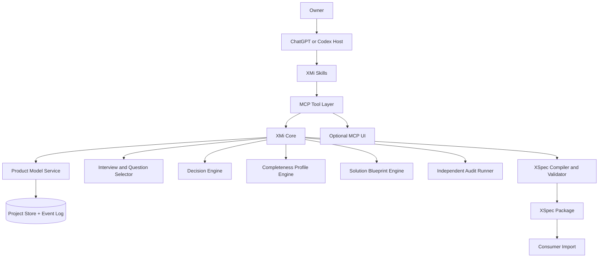

# 03 - System Architecture

## 1. Architectural style

XMi V0 uses a domain-core plus adapters architecture.



## 2. Main components

### 2.1 Host adapters

- ChatGPT plugin surface.
- Codex desktop/app surface.
- Codex CLI.
- Standalone Skill + MCP fallback for environments without plugin installation.

Host adapters contain no product rules.

### 2.2 Skills

Skills teach the host model when and how to use XMi tools. V0 uses focused skills:

- `xmi-discovery`
- `xmi-audit-export`
- optional `xmi-xdev-handoff`

### 2.3 MCP tool layer

Provides typed, narrow operations. It enforces authorization, validation, idempotency and structured errors.

### 2.4 XMi Core

Pure domain logic where possible:

- Product Model transitions;
- provenance and confirmation rules;
- interview stage progression;
- question scoring;
- profile completeness rules;
- decision lifecycle;
- readiness hard gates;
- XSpec compilation and validation.

Domain logic must not depend on ChatGPT-specific UI objects.

### 2.5 Project Store

Canonical storage contains:

- current validated Product Model snapshot;
- append-only domain event log;
- schema version;
- exported XSpec versions;
- audit findings;
- idempotency keys.

Recommended V0 adapters:

- local SQLite adapter for Codex/private development;
- remote durable database adapter only when ChatGPT private testing requires hosted multi-session state.

Do not bind domain logic directly to one provider.

### 2.6 Independent Audit Runner

The Auditor receives a read-only snapshot and a strict audit contract. It cannot mutate canonical state. Findings return to the primary workflow as proposed issues.

Preferred isolation order:

1. Codex/ChatGPT subagent with fresh bounded context when supported;
2. separate model invocation with the audit-only prompt;
3. deterministic validators only, while clearly marking LLM audit unavailable.

### 2.7 Optional UI

UI is for inspecting, editing and confirming structured information. It is not required for tool correctness.

V0 UI candidates:

- Product Map;
- Decision Card;
- Open/Blocking Questions;
- Readiness Report.

## 3. Suggested implementation layout

```text
xmi/
  AGENTS.md
  README.md
  docs/
  schemas/
  packages/
    core/
      domain/
      interview/
      profiles/
      decisions/
      readiness/
      xspec/
    storage/
      sqlite/
      memory-test-adapter/
    mcp-tools/
    shared-types/
  apps/
    mcp-server/
    plugin-ui/
  plugin/
    .codex-plugin/
    skills/
    .mcp.json or .app.json
  tests/
    unit/
    contract/
    conversation-fixtures/
    adversarial/
    e2e/
```

M0 may adjust packaging to the current official plugin scaffolding, but not the component boundaries.

## 4. Recommended technical baseline

- TypeScript.
- Current supported Node.js LTS at implementation time.
- Official MCP TypeScript SDK.
- Zod for runtime schemas plus generated/checked JSON Schema.
- SQLite for local prototype persistence.
- Vitest or equivalent for unit/contract tests.
- A simple migration layer with transactional upgrades.

Alternative technology requires an ADR and Owner approval.

## 5. State transition discipline

All canonical mutations pass through domain commands:

```text
command -> validate -> calculate events -> transactional append -> update snapshot
```

The model must not be given a generic “write arbitrary JSON” tool.

## 6. Resilience

- Every mutation has an idempotency key.
- Failed tool calls must not partially update state.
- XSpec exports are immutable versions.
- Resume reads canonical state, not the old transcript.
- Schema migration creates a backup/checkpoint before write.
- Audit failure cannot corrupt Product Model state.

## 7. Architecture decisions

See `docs/adr/` for the initial locked decisions.

## 8. Delivery Mode Policy Engine

Add a deterministic `DeliveryModePolicy` domain service between Product Model and Readiness/XSpec compilation. It owns:

- mode recommendation candidates and reasons;
- explicit Owner selection event;
- mapping from mode to XMi readiness target and assurance level;
- risk-triggered scoped minimum modes;
- valid resolution of mode conflicts;
- upward mode-gap calculation;
- export/inheritance metadata.

The model may explain and propose. Deterministic policy code validates transitions and prevents a lower mode from claiming a higher readiness level.
