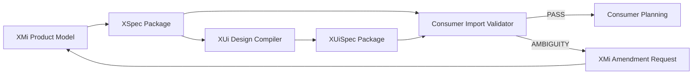

# 12 - XUi, XDev and XMem Integration

## 1. Responsibility matrix

| Engine | Phase | Authoritative responsibility |
|---|---|---|
| XMi | Before development | Product intent, Product Model, requirements, flows, acceptance criteria, Owner decisions, solution blueprint, XSpec readiness |
| XUi | Before development, and again after implementation | Information architecture, navigation, screen inventory and screen-state graph, design direction, design tokens and component contracts, content rules, responsive and accessibility rules, UI acceptance criteria, XUiSpec readiness; after implementation, UI compliance verification of the running implementation |
| XDev | Implementation | Implementation architecture, milestones, tasks, dependency DAG, dynamic Agent team, code/review/QA/integration delivery state |
| XMem | Background, across all phases | Engineering execution memory, bounded Agent context, evidence, handoff and freshness verification |

**Phases, not authorship.** "Before development" is a phase boundary, not an ownership claim: XMi authors the product contract (XSpec) and XUi authors the UI contract (XUiSpec), both inside that phase.

**Independent review sits on the authoring side, not only in XDev.** XMi owns specification review (`Spec Reviewer`, `Independent Product Auditor`; see `docs/18-UNIFIED-DELIVERY-MODES.md` section 4); XUi owns design review (`UX Reviewer`, `Independent UX Audit`). XDev's review is review of the code and of its own delivery.

## 2. XMi -> XUi and XMi -> XDev handoff

`XSpec` is the single contract XMi exports. Both XUi and XDev consume it; neither may silently rewrite product facts.



XMi exports product facts. XUi compiles them into `XUiSpec` only; XDev implements them. Ambiguity from either consumer returns to XMi through the same amendment path (section 3).

## 3. Consumer ambiguity feedback (XUi and XDev)

Both downstream consumers return ambiguity to XMi in the same structured shape. For XDev, the future V0.2 contract is:

```json
{
  "type": "xdev_spec_ambiguity",
  "xspec_id": "XSPEC-...",
  "xspec_version": "0.2.0",
  "affected_ids": ["REQ-...", "AC-..."],
  "question": "...",
  "why_blocking": "...",
  "suggested_options": [],
  "requested_by": "planner|architect|worker|reviewer"
}
```

XUi returns the same structure - affected IDs, the blocking question, the reason and the options - under this section. No separate XUi consumer-runtime contract file exists in the V0.1 repository; `docs/02-PRODUCT-ROADMAP.md` V0.2 owns the real XUi/XDev adapters and contract tests. XMi must not require a design-specific feedback type in order to accept it.

XMi turns either request into an Owner decision or clarification, then exports an amended XSpec.

## 4. XMem integration

**XMem already exists.** The XMem engine in the X Suite is the existing XMem product (version `R3.2.1` at the time of writing), not a component to be built as part of XMi. The XMi adapter therefore targets XMem's **public contracts**; XMi does not define XMem's internals, storage format or versioning, and must not assume them.

XMi V0 core does not require XMem. A later adapter may use XMem for:

- bounded resume context;
- execution memory about failed interview paths;
- cross-agent Auditor handoff;
- evidence that a specific XSpec version was exported.

It must not use XMem as the only store for:

- confirmed requirements;
- Owner decisions;
- Product Model;
- readiness status;
- XSpec content.

XMem references authoritative XMi IDs and versions.

## 5. Version negotiation

XSpec manifest declares:

- `xspec_schema_version`;
- `xmi_version`;
- `xdev_min_version` or compatibility range;
- `xui_min_version` or compatibility range;
- integrity hash.

Consumers reject unsupported major versions with a structured error.

## 6. No shadow states

- XMi must not mirror XDev task progress or XUi design progress.
- XDev must not maintain a second editable copy of Product Requirements.
- XUi must not maintain a second editable copy of Product Requirements or of XSpec; it holds `XUiSpec` only.
- XMem must not duplicate the XMi Product Model or XDev Project State.

## 7. Unified delivery-mode handoff

XMi exports the one canonical project mode. XUi and XDev inherit it. XDev's adapter maps:

- `FAST_VALIDATION` -> Developer Agent only, with mandatory basic self-check;
- `FAST_DEVELOPMENT` -> Developer Agent + independent Reviewer;
- `PRODUCT_GRADE` -> Developer + Reviewer + QA/Test Verifier.

The adapter also consumes scoped minimum-mode overrides. It must not silently lower them. XMem applies mode-aware evidence depth internally and never asks the Owner for a separate selection.

XDev ambiguity or risk feedback may request an upgrade or gap analysis, but XMi/Owner remains authoritative for product-scope decisions.
